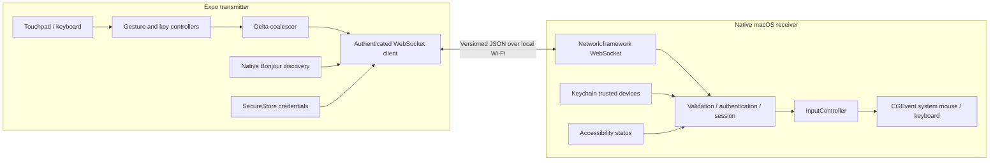

# Remote Mac Control

A phone touchpad and keyboard for your Mac, over the same local network. The repository contains two applications: an Expo transmitter for iPhone/Android and an independent native Swift receiver for macOS. The receiver posts real system mouse and keyboard events.

Bluetooth backup is available in rebuilt native phone apps. See the [Bluetooth setup, architecture and device verification guide](docs/BLUETOOTH.md).

### Sound & Light

Open the fourth bottom tab, **Sound & Light**, and tap the centre circle to switch between **Sound** (Mac output volume) and **Light** (Mac display brightness). Draw around the button with one finger: clockwise increases the selected control, anticlockwise decreases it. Changes follow the arc continuously; partial circles work, and additional turns continue adjusting. The screen shows the amount of rotation, not a measured Mac level.

One full turn sends 64 fine media-key increments (Option-Shift), approximately the range of the native control. Lifting your finger, adding another finger, switching modes, leaving the screen, or losing the connection cancels the current stroke. Both Wi-Fi and Bluetooth use the same command. Rebuild/update the Mac receiver and phone app; older receivers show an update prompt. Brightness follows macOS brightness-key support, so external monitors may need their own controls. Fixed-volume audio outputs may not respond to Mac volume keys.

### Shake-to-Action

On Android, choose **Calibrate gestures** in the Gestures tab or its Configure sheet. Select one label or all seven, then record **5 takes per label**. Every completed recording with sensor data is kept as performed; calibration does not judge whether the movement was correct. Tap Record when ready for each take and Save after the selected set is complete. During use, a movement resembling **any one** saved example can trigger that label’s action. The gesture illustrations are optional examples, and you can teach your own motion. Earlier calibration remains saved until you save new takes. If you leave the app, **Continue calibration** resumes with completed takes retained while the app process remains alive. Calibration works without a Mac connection and pauses gesture actions while you practice. **Recalibrate** is available at any time; canceling keeps previous training. Saved patterns stay on the phone and apply in foreground and background, including the home-screen widget. See [gesture learning](docs/GESTURE_LEARNING.md) for recognition and verification details.

Easy movements to try are a gentle tilt left and return, tilt right and return, move the upright phone a short distance up and return, or move it down and return. Choose a distinct, comfortable motion for each shortcut and repeat that same motion for its five takes. These are optional examples: existing ten-take training stays usable until you choose to replace it.

Motion recognition uses only X (left/right) and Y (up/down), with the phone held upright and its screen facing you. Z (toward/away) is ignored for detecting, matching, and settling a gesture. Saved recordings are adapted automatically without requiring another five takes. Calibration also lets you inspect recorded takes: choose a movement and take to see the X/Y graph, numeric readings, and movement measurements. New saved takes retain the original accelerometer samples in g, including gravity and the preparation period. Older training without raw readings is adapted from its normalized 32-point matching shape; original readings cannot be recovered. Original XYZ readings remain available in the JSON export, but depth is not used for recognition. You can share the selected movement's data for analysis. Viewing readings does not change recognition rules: compare several takes and ordinary non-gesture motion before choosing a new formula.

On Android, add the **Remote Mac Gestures** home-screen widget from **Gestures → Configure → Add home-screen widget**. Tap the widget to switch motion gestures on or off without opening the app. Its ON/OFF label shows your saved choice, while the smaller status shows whether it is listening or still connecting. The app switch, widget, and notification Stop action stay in sync. Enabling from the home screen uses background gestures and your saved Wi-Fi pairing; open and pair the app first if the widget asks for setup. Turning gestures off preserves your mappings and saved connection so the widget can turn them back on.

Open the **Gestures** tab beside **Mouse**, **Keyboard**, and **Sound & Light** for Shake-to-Action, its saved master switch, recorded shake count and **Configure** sheet. Mouse and Keyboard use the full control area; enabled motion shortcuts continue listening across all four tabs. Choose **Directional** or **Shake count**, then tap any gesture to assign Screenshot, Lock/Unlock Mac, Kill current app, Photo Booth, or Disabled. Drag the grip beside a gesture under **Card order** to arrange the cards from left to right, then top to bottom. Directional and Shake count remember their own orders across app restarts; **Reset order** restores the current mode's default layout. Moving a card keeps its gesture and assigned action together. The two modes do not run simultaneously.

| Directional gesture | Default Mac action |
| --- | --- |
| Right | Screenshot |
| Left | Lock/Unlock Mac |
| Left → Straight | Kill current app |
| Right → Straight | Open Photo Booth |

For default gestures and earlier calibration, hold the phone upright in portrait, screen facing you. **Left** and **Right** use a single sideways flick. For **Left → Straight** or **Right → Straight**, tilt the top of the phone to that side, pause briefly, then return it upright to its starting angle. The action runs after the return; simply holding the phone tilted does not complete the gesture. You can retrain either label separately with five takes of your own motion; saved examples define its recognition. Existing action assignments and card order carry over from the previous Left → Right and Right → Left gestures. The new tilt movements start with default tuning and can be calibrated individually; saved single-flick and shake calibration is retained.

**Shake count** retains the original mappings: one screenshot, two kill current app, three Lock/Unlock Mac. Distinct back-and-forth shakes with short pauses are grouped, then single/double actions resolve after a 1.1-second settling window. A cooldown prevents repeated actions. The **Shakes** badge and last gesture remain visible beside listening status.

Motion shortcuts run **one action at a time**. Recognition pauses as soon as a mapped action starts and resumes after the Mac confirms completion or failure. Movements during that pause are discarded. If the connection drops, the app checks the same action without repeating it; an unknown outcome stays paused and offers **Resume gestures**. Both the phone and Mac receiver need the update. Screenshot completion means its shortcut was sent, not that the image file has finished saving.

On the updated **Android** app, **Keep active in background** uses a native foreground service with a persistent notification and **Stop gestures** action. It continues when Home is pressed, the screen turns off, or the task is swiped away. Background Mac actions require a saved, paired Mac Wi-Fi address; phone apps and URLs can work offline; foreground controls still support Wi-Fi and Bluetooth. Android Force Stop and reboot stop listening until the app is reopened. Notification permission is requested when background mode starts. Continued sensor listening uses extra battery. Gestures pause while configuration is open, cancel across connection/lifecycle changes, and never replay after reconnection. Disconnect/Forget also disables gestures.

On iPhone, shake-count mode works only while the app is open; directional/background support is Android-specific. Browser previews display configuration without listening for motion. Install both the updated receiver and native phone build; Expo Go cannot provide the background module.

**Lock/Unlock Mac** checks the current Mac session: an unlocked session is locked with Control-Command-Q; a locked session first wakes an asleep display and waits for it to be ready, then receives Space, the configured Mac password, and Return, with a short pause between steps. In the **Mac receiver window**, save your Mac login password to enable unlocking; it is stored in that Mac's login Keychain and can be cleared there. For terminal launches, `MAC_UNLOCK_TEXT` overrides the saved password. The password stays on the Mac and is never sent by or entered on the phone. Existing `lock` gesture mappings, including Android background mappings, keep working without migration.

Unlocking requires an already logged-in Mac session with the receiver running and Accessibility enabled; it cannot unlock FileVault before login or start the receiver after a restart. Updated gesture clients receive an action-completion result based on the observed lock state. A fully sleeping Mac must wake before its receiver can accept a command; this display-wake change does not add Wake-on-LAN. Kill current app can discard unsaved work; the receiver, Finder and system UI are excluded. Screenshot/lock shortcuts must be enabled in macOS. Photo Booth uses its installed bundle identifier. A sent command is not proof that macOS completed it.

The native Android app and Mac receiver have been installed locally. Automated tests, native UI observations and remaining physical acceptance checks are recorded in [verification evidence and boundaries](docs/VERIFICATION.md).

## Quick start

From this repository's root:

```sh
npm install
npm run receiver
```

This builds `dist/Remote Mac Control.app` and runs its executable in the foreground. Keep the receiver running. In its window, enable Accessibility using the Settings button and note the Mac address and six-digit pairing code.

In another terminal:

```sh
cd transmitter
npx expo start
```

Open the project in an installed **development build** to enable automatic Mac discovery. Because `expo-dev-client` is installed, the default Expo command targets a development build. If you only have a compatible Expo Go version:

```sh
cd transmitter
npx expo start --go
```

In Expo Go, open Connection & settings and enter the receiver's hostname or IP manually. Do not enter `http://`, `ws://`, a path, or credentials in the hostname field. The default port is **9876**. Enter the code from your Mac, then select **Start controlling**. Mouse and Keyboard remain one tap apart.

### Update the installed Android app over USB

Connect and authorize your phone, then use **Transmitter: Sync to Android via USB**
in VS Code's **Terminal → Run Task** or **Run and Debug**. From the repository root:

```sh
python3 .vscode/sync-android-usb.py
```

This builds the current JavaScript and native code and updates Remote Mac while
retaining its saved pairing and settings. It uses the current app version; no
version bump is needed for each local sync. Use `--check` to check prerequisites
without installing. See [USB sync instructions](.vscode/README.md) for options.

### Android development over USB

Keep the Mac receiver running, connect the Android phone by USB, enable USB debugging, and accept the phone's debugging authorization. From the repository root:

```sh
adb devices
adb reverse tcp:9876 tcp:9876
adb reverse tcp:8082 tcp:8082
cd transmitter
npx expo start --go --localhost --port 8082
```

The phone must appear as `device` in `adb devices`. In another terminal, open the project in the installed Expo Go app:

```sh
adb shell am start -a android.intent.action.VIEW -d exp://127.0.0.1:8082 -p host.exp.exponent
```

In **Connection & settings**, enter hostname **127.0.0.1** and port **9876**, then pair with the code shown on the Mac. Port **8082** serves the app from Metro; port **9876** connects to the Mac receiver. If Metro uses a different port, update its reverse command, Expo command, and launch URL together.

Rerun both `adb reverse` commands after reconnecting USB. With multiple devices or emulators connected, use `adb -s <serial>` for each reverse and launch command; copy the serial from `adb devices`.

## Requirements and dependencies

| Component | Requirements |
| --- | --- |
| JavaScript development | Node.js 22.13+; npm; install from the root workspace |
| Native receiver runtime | macOS 13+; Accessibility permission; reachable local network |
| Receiver build | Swift 6 and Apple command-line tools; no Node runtime needed by the built app |
| Receiver tests | macOS 14+ for the installed Swift Testing framework; use the supplied wrapper |
| iOS native development build | Full Xcode, iOS SDK and device signing; or EAS Build |
| Android native development build | Android SDK, suitable JDK and connected phone/emulator; or EAS Build |

The installed stack is Expo 58, React 19.3, React Native 0.88, TypeScript, and React Native Gesture Handler 3.3. Expo SecureStore holds phone credentials, AsyncStorage holds preferences, and Expo Crypto, Haptics, KeepAwake and SafeAreaContext support the mobile experience. The receiver uses only Apple frameworks: AppKit, Network, CoreGraphics, ApplicationServices, Security and CryptoKit.

This workspace was initialized on Apple Silicon macOS 26.6.2 with Node 22.23.2 and Swift 6.2. Full Xcode, an Android SDK and a Java runtime were unavailable; JavaScript bundle export is not a native phone build.

## Architecture

```text
RemoteControl/                         # remote-mac-control monorepo
├── transmitter/                       # Expo mobile application
│   ├── components/                    # Trackpad, keyboard, shared controls
│   ├── screens/                       # Connection and settings
│   ├── gestures/                      # Native recognizers + pure interpretation
│   ├── networking/                    # WebSocket session, endpoint validation
│   ├── services/                      # Coalescing, keyboard, settings, credentials
│   ├── modules/lan-discovery/          # Swift/iOS and Kotlin/Android Bonjour
│   └── plugins/                       # Native local-network configuration
├── receiver/                          # Standalone Swift package/application
│   ├── Sources/ReceiverCore/          # Protocol, auth, sessions, input dispatch
│   ├── Sources/RemoteMacReceiver/     # AppKit UI and actual CGEvent sink
│   ├── Tests/                         # Pure receiver tests
│   └── scripts/                       # Build, package, run and test
├── shared/                            # Language-neutral manifest + wire types
├── scripts/                           # Integration-test orchestration
└── docs/                              # Protocol, verification, design and plan
```



The transmitter captures intent, maintains connection state and sends protocol messages. The receiver authenticates devices, validates every message and translates input into native events. Neither application imports the other application's runtime. `ReceiverIntegrationHarness` is a test utility, not a third application or production listener.

## Controls

| Interaction | Result |
| --- | --- |
| One-finger movement | Relative cursor movement with sensitivity and bounded acceleration |
| One-finger tap / double tap | Left click / double click |
| Hold one finger, then move | Hold left mouse button and drag; release on lift |
| Left / Right click buttons | Physical button down/up; hold a button while moving on the pad to drag |
| ×2 button | Explicit double click |
| Left / Right / Up / Down buttons inside the pad | Direct Control-arrow shortcuts for desktops and macOS overview, with complete modifier/key press and release |
| Two-finger movement | Horizontal and vertical native pixel scrolling |
| Two-finger tap | Right click, when enabled |
| Pinch | Application zoom through Command-plus/minus shortcuts |
| Three/four-finger swipe | Desktops, full-screen apps and Mission Control using macOS shortcuts |
| Keys with a small alternate label | Tap for the main character; hold for the alternate once (for example, hold `1` for `!`) |
| Other keyboard keys | Real key down/up; holding Backspace, Space, arrows and other repeatable keys repeats after a short delay |
| Modifier keys | Tap to latch Shift, Control, Option or Command; tap again to release |
| Fn / # | Punctuation, F1–F12, Home/End, Page Up/Down and forward Delete |
| Unicode composition | The Compose field stays below the scrolling keys and above the phone keyboard. Review your text, tap Send, or tap Done to dismiss the phone keyboard without clearing the draft. |
| Release all | Clear held remote buttons/keys and sticky shortcut modifiers |

The keyboard also includes arrows, Tab, Escape, Backspace, Return, Space, Caps Lock and quick Command shortcuts. Portrait and landscape layouts are supported. The Mac uses its current keyboard input source for ANSI physical key positions; use the Unicode field for layout-independent text.

Multi-finger system actions are public keyboard shortcut mappings. They do not synthesize private macOS trackpad events. Enable the corresponding shortcuts under macOS Keyboard → Keyboard Shortcuts → Mission Control. Zoom depends on the foreground application's shortcut support. Two-finger movement on the phone scrolls in either axis. Three- or four-finger horizontal swipes switch desktops or full-screen apps; an upward swipe opens Mission Control. The protocol additionally supports two-finger horizontal navigation for alternative clients.

Pointer and scroll samples are coalesced outside React rendering at approximately 60 Hz. Key/button transitions flush preceding motion. Backpressure ends an unsafe session instead of queuing stale input. Backgrounding, mode changes, disconnect, sleep, timeout and permission loss release tracked inputs.

## Building the phone app

### VS Code launch commands

Open **Run and Debug**, choose an entry from [.vscode/launch.json](.vscode/launch.json), and press **F5**:

- **Transmitter: Build Android APK (EAS)** runs `eas build --platform android --profile preview --wait` from the transmitter directory. It builds a standalone APK on Expo's servers and prints its download link when complete. The `eas` CLI must be installed (`npm install -g eas-cli`); sign in with `eas login`. The first build may prompt to link the Expo project and set up Android signing.
- **Receiver: Sync latest code and restart** runs `npm run sync:receiver`. It compiles the latest Swift source, gracefully quits this checkout's running receiver, repackages/signs [dist/Remote Mac Control.app](<dist/Remote Mac Control.app>), and opens it again. Saved pairings are preserved. An unrelated process using the receiver port must be stopped separately. Rebuilding with ad hoc signing may require re-enabling Accessibility for the updated app.

Receiver sync updates the app in this checkout's `dist` folder. If you previously copied it to `/Applications`, that separate copy is not updated. The command supports the same `REMOTE_MAC_PORT`, `REMOTE_MAC_ALLOWED_ORIGINS`, and `REMOTE_MAC_SIGNING_IDENTITY` environment variables as the receiver scripts.

### Native builds

The local discovery module is real native code. Expo Go cannot dynamically load it; a development build includes it. See [Expo's development-build guide](https://docs.expo.dev/develop/development-builds/introduction/) and the [module notes](transmitter/modules/lan-discovery/README.md).

Local builds, after installing the relevant platform toolchain:

```sh
cd transmitter
npx expo run:ios --device
# Or:
npx expo run:android --device
```

These commands generate native projects and build the application. After installation, ordinary JavaScript changes use `npx expo start`. Rebuild after changing native modules or native configuration. Generated `ios/` and `android/` projects are ignored; native changes belong in the local module/config plugin.

EAS alternatives, after signing in to your Expo account and configuring project/signing credentials:

```sh
cd transmitter
npx eas-cli login
npx eas-cli build --platform android --profile development
npx eas-cli build --platform ios --profile development
```

Build only the platform you need. The Android development/preview profiles produce APKs. iOS physical-device distribution requires appropriate Apple signing/provisioning; `development-simulator` builds target the simulator. Use `--profile preview` for an internal standalone build without a development server. No EAS build or store submission was performed in this workspace.

`app.config.ts` sets the app identifiers, orientation, SecureStore and development-client plugins. `withLocalNetwork.js` declares iOS Local Network usage and `_remotemac._tcp`, permits local network loads, and enables Android cleartext LAN sockets plus network/multicast permissions. Expo 58 currently targets Android API 36; if upgrading to API 37+, enable the plugin's `targetSdk37` option and retain the runtime permission check before local connections.

## Receiver packaging and permissions

```sh
npm run build:receiver
open "dist/Remote Mac Control.app"
```

The bundle is signed ad hoc. Put it in a stable location such as `/Applications` before granting Accessibility. A Developer ID signature can be selected with `REMOTE_MAC_SIGNING_IDENTITY`; notarization and a universal/Intel release build are separate distribution work. Closing the window leaves the menu-bar receiver running; use its Quit command to stop it.

Enable **Remote Mac Control** in **System Settings → Privacy & Security → Accessibility**. The receiver checks permission and reports missing access to the phone instead of silently discarding control. The Settings button opens the relevant pane; the app never grants its own permissions. See [Apple's Accessibility instructions](https://support.apple.com/guide/mac-help/allow-accessibility-apps-to-access-your-mac-mh43185/mac).

Allow Local Network access on the phone and on macOS if prompted. Permit incoming connections for the receiver when the firewall asks. Do not disable your firewall globally. Input Monitoring and Screen Recording are not required by this implementation. Rebuilding an ad-hoc-signed app can invalidate an existing Accessibility grant; remove and re-add the new bundle if needed.

To use another port:

```sh
REMOTE_MAC_PORT=9877 npm run receiver
```

The receiver advertises its actual port. For manual connections, enter the same port on the phone. There are no hard-coded Mac addresses and no cloud relay.

## Pairing and security

Pair from the phone using the six-digit code visible in the Mac window. Codes expire after two minutes and rotate after a successful pairing. Five failed attempts within one minute impose a one-minute global code lockout. Saved valid tokens can still authenticate during that lockout.

The phone generates a device ID and stores its per-Mac random 256-bit token in SecureStore. The receiver stores token hashes and trusted-device metadata in the login Keychain. Browser preview credentials exist only in memory. Up to 32 devices may be trusted, but only one controls the Mac at a time. Revoke a device in the Mac window to disconnect it and invalidate its token; Forget pairing on the phone only deletes that phone's local credential.

Version 1 uses **unencrypted `ws://`**. Authentication prevents unknown clients from controlling input; it does not prevent another party on the LAN from observing traffic or stealing a bearer token. Use a trusted network, never forward the port to the Internet, and avoid public/guest Wi-Fi. Private-address filtering also admits private VPN peers. WSS with a verified receiver identity is a priority before use on untrusted networks.

The receiver rejects public-address peers and unapproved browser origins, bounds frames to 16 KiB, validates types/fields/ranges, rejects replayed sequence numbers, limits messages to 300 per second, and caps transport connections at eight. See the [wire protocol](docs/PROTOCOL.md) and [receiver details](receiver/README.md).

## Browser preview

```sh
npm run web
```

The preview is useful for UI and manual connection testing; it cannot provide phone Bonjour discovery or establish physical multitouch behavior. Browsers are rejected by the receiver by default. To deliberately connect a local preview, start the receiver with the exact page origin:

```sh
REMOTE_MAC_ALLOWED_ORIGINS=http://localhost:8081 npm run receiver
```

Use the actual port printed by Expo. Origins must match scheme, hostname and port; comma-separated exact origins are supported, `*` is not a wildcard. An HTTPS preview may block plaintext WebSockets as mixed content. Native phone connections do not need this browser allowlist.

## Testing and diagnostics

The receiver logs every incoming JSON command with its parameters and result. Run `npm run receiver` to see live terminal logs, or use the [macOS Console/log-stream instructions](receiver/README.md#diagnostics-and-tests) for the app opened from Finder. Pairing credentials and composed text are redacted; key names and modifiers remain visible for shortcut debugging.

```sh
npm run check
npm run test:integration
npm run build:receiver
```

`check` verifies generated protocol files, TypeScript, transmitter/shared tests and receiver tests. The Swift test wrapper accommodates Apple's standalone command-line toolchain. Integration tests use actual native WebSocket transport on loopback with in-memory trust and a recording input sink; they never move the cursor or write trusted devices to the production Keychain.

Additional checks:

```sh
cd transmitter
npx expo-doctor
npx expo export --platform all
```

From the root, inspect the packaged receiver without starting its listener:

```sh
"dist/Remote Mac Control.app/Contents/MacOS/RemoteMacReceiver" --diagnostics
```

For an explicit, bounded real-input check after granting Accessibility:

```sh
"dist/Remote Mac Control.app/Contents/MacOS/RemoteMacReceiver" --verify-input
```

That check creates its own focused window, moves the physical cursor eight points and restores it, then verifies Unicode, Backspace down/up and Command-A in its own field. It cancels if focus changes, starts no server, and accesses no saved credentials. It prints JSON and exits nonzero on failure. Ordinary automated tests use a recording sink instead.

## Troubleshooting

| Symptom | Check |
| --- | --- |
| No Mac found | Receiver running; same reachable LAN; phone Local Network permission; development build installed. Try manual IPv4. Guest/client-isolated Wi-Fi can block mDNS or peer traffic. |
| Manual connection times out | On Wi-Fi, use the address displayed by the receiver. For USB with `adb reverse tcp:9876 tcp:9876`, use `127.0.0.1` on the phone. Check the receiver port, forwarding, Wi-Fi, firewall, VPN and Mac sleep state. An Expo tunnel does not tunnel this receiver. |
| Pairing code rejected | Use the current code; it expires/rotates. Wait one minute after lockout and reconnect if the 30-second pairing session expired. |
| Permission required | Enable the actual packaged app under Accessibility; a command-line binary and an app bundle may have different grants. Re-add the app after a signature change. |
| Mac already controlled | Disconnect the other phone or use the receiver menu's Disconnect command. |
| Browser connection rejected | Opt in with the exact `REMOTE_MAC_ALLOWED_ORIGINS` value; check mixed-content restrictions. |
| Native module missing | Expo Go cannot load it. Rebuild/install a development client after native changes. |
| Shortcut/zoom ignored | Confirm the foreground app and macOS shortcut settings; ANSI key positions follow the Mac's active layout. |
| Reconnect stopped | After bounded automatic attempts, use Reconnect. Unlock the phone if secure credential storage is unavailable. |
| Port already in use | Quit the other receiver or use `REMOTE_MAC_PORT` and the matching phone setting. |

## Known limits and next improvements

- Physical iPhone/Android LAN discovery, permission prompts and multitouch still need real-device verification. Same-Mac integration and JavaScript exports do not establish those results.
- There is no TLS, screen streaming, Internet relay, clipboard synchronization, force touch, inertia/momentum model or private macOS multitouch injection.
- F1–F12 are function keys, not media/brightness controls. Apps and protected system contexts may reject synthetic input.
- Caps Lock presentation tracks this phone's toggles; it is not synchronized feedback from a physical Mac keyboard. Physical key labels assume ANSI positions; Unicode composition is the layout-independent path.
- Android discovery prefers IPv4 and skips numeric IPv6 addresses with scope IDs; use a manual IPv4 address in that configuration.
- The macOS bundle is an ad-hoc local build, not a notarized installer or App Store release.

Next priorities are physical-device test coverage, encrypted transport with receiver identity verification, stable release signing/notarization, native build CI, synchronized lock-key state, and measured latency/gesture tuning. A binary codec can replace JSON behind the existing transport/input boundary after profiling shows it is useful.

## Preview


### Gesture action lists

Each gesture can run an ordered list of Mac actions, installed phone apps, installed Mac apps, Mac shell commands, and URLs on either device. Open **Gesture controls** and expand a gesture to add, edit, remove, or reorder its actions. See [Gesture action lists](docs/GESTURE_ACTION_LISTS.md) for execution behavior, background phone-action notifications, and rebuild requirements.
