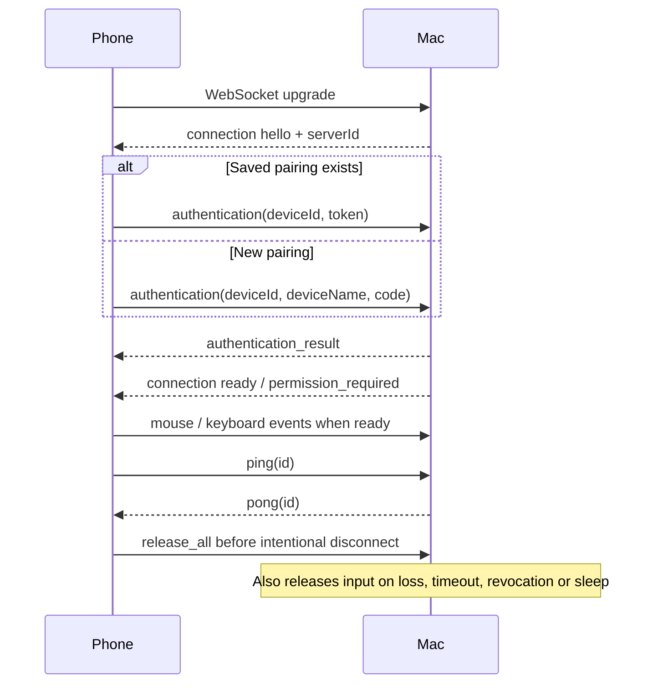

# Remote Mac protocol, version 1

The phone and receiver communicate using UTF-8 JSON WebSocket text messages over a persistent TCP connection. The default address is `ws://<mac-host>:9876/`. There is no HTTP control API, cloud relay or required WebSocket subprotocol. Bonjour advertises `_remotemac._tcp` in `local.` with `id` and `v` TXT fields; advertisements locate a receiver and do not authenticate it.

`shared/protocol-manifest.json` is the language-neutral source for version, limits, message names, keys and enum values. `npm run protocol:generate` produces `shared/constants.ts` and `receiver/Sources/ReceiverCore/ProtocolConstants.swift`. The TypeScript union/validator and Swift validator implement that contract, with common acceptance/rejection examples in `shared/fixtures.json`. `npm run protocol:check` detects generated-file drift.

## Envelope

Every message has these required fields:

| Field | Type | Meaning |
| --- | --- | --- |
| `v` | integer | Exactly `1` |
| `type` | string | A defined message name below |
| `seq` | integer | Nonnegative safe integer; client values must strictly increase on each socket |
| `timestamp` | integer | Nonnegative safe integer, Unix milliseconds |

```json
{"v":1,"type":"mouse_move","seq":8,"timestamp":1793000000000,"dx":12,"dy":-4}
```

The transmitter starts client sequences at 1 for each new socket. The receiver rejects reused/decreasing values. Server authentication and pong responses echo the triggering sequence; unsolicited server status/errors may use 0. `timestamp` is metadata, not a clock-synchronization or cross-session replay defense. New sessions never replay old input.

Frames are limited to **16,384 UTF-8 bytes**. Unknown fields, unknown message types, wrong direction, missing fields, invalid enum values, non-finite numbers and out-of-range values are rejected. Integers must not exceed JavaScript's maximum safe integer, 9,007,199,254,740,991. String limits below count UTF-16 code units consistently across Swift and TypeScript.

## Client → receiver

The table lists fields in addition to the envelope.

| Type | Fields | Semantics |
| --- | --- | --- |
| `authentication` | `deviceId`: UUID; `deviceName`: 1–80 units; exactly one of `code` or `token` | Code: six decimal digits including leading zeros. Token: 64 lowercase hexadecimal characters. |
| `mouse_move` | `dx`, `dy`: finite numbers in −1000…1000 | Relative movement; held buttons determine drag event type. |
| `mouse_down` | `button`: `left`, `right` or `middle` | Hold a physical button; duplicate down is ignored. |
| `mouse_up` | `button` | Release a tracked button; unmatched up is ignored. |
| `mouse_click` | `button`; `count`: 1 or 2 | Emit matching down/up events with native click counts. Ignored if that button is already held. |
| `mouse_scroll` | `dx`, `dy`: finite numbers in −1000…1000 | Two-axis pixel scrolling. The transmitter applies natural-scroll preference before sending. |
| `mouse_gesture` | `gesture`: `zoom`; `amount`: −1…1 | Positive/negative values produce one application zoom-in/out shortcut; zero does nothing. |
| `mouse_gesture` | `gesture`: `swipe`; `direction`: `left`, `right`, `up`, `down`; `fingers`: 2, 3 or 4 | Native shortcut mapping, described below. Do not include `amount` for swipe. |
| `keyboard_down` | `key`: supported name; `modifiers`: unique array; `repeat`: boolean | Actual key-down. A repeated down for an already-held key needs `repeat: true`. |
| `keyboard_up` | `key`; `modifiers` | Actual key-up, with modifiers remaining active after release. |
| `keyboard_text` | `text`: 1–1024 units | Unicode composition channel, separate from physical shortcuts. |
| `system_action` | `action`: `screenshot`, `kill_app`, `lock`, `photo_booth`, `open_app`, `run_command`, or `open_url`; `id`: 1–64 units (optional only for legacy built-ins); action-specific `appId`, `command`, or `url` | Release held input, then perform the selected Mac action. Requires authentication and Accessibility permission. Updated gesture clients supply an ID and require `action_completion`. |
| `system_action_status` | `action`; `id`: 1–64 units | Read the outcome of an existing action without executing it. Requires authentication, including when Accessibility permission is unavailable. |
| `system_adjust` | `control`: `volume` or `brightness`; `steps`: nonzero integer in −16…16 | Release held input, then send that many fine native media-key increments. Positive increases; negative decreases. Requires the `system_adjust` capability, authentication and Accessibility permission. |
| `release_all` | none | Release tracked buttons/keys and shortcut modifiers. Safe while permission is missing. |
| `ping` | `id`: 1–64 units | Application heartbeat, echoed in `pong`; allowed before authentication. |

Modifiers are `shift`, `control`, `option` and `command`. Their array represents the complete current shortcut-modifier state, at most four unique values. Send actual modifier down/up lifecycles as well as this state on ordinary keys. Caps Lock is a lock-key event, not an item in `modifiers`.

Supported key names:

```text
a–z, 0–9
space enter backspace delete tab escape
shift control option command caps_lock
left right up down home end page_up page_down
f1 f2 f3 f4 f5 f6 f7 f8 f9 f10 f11 f12
minus equal bracket_left bracket_right backslash
semicolon quote comma period slash backtick
```

These map to ANSI physical key positions and the current macOS input source. Function keys do not imply media/brightness commands. `keyboard_text` uses CGEvent Unicode payloads; the mobile controller releases held input first, and the receiver ignores composed text while shortcut modifiers remain active.

Example Command-C lifecycle, with each JSON object sent as a separate WebSocket message:

```json
{"v":1,"type":"keyboard_down","seq":20,"timestamp":1793000000000,"key":"command","modifiers":["command"],"repeat":false}
{"v":1,"type":"keyboard_down","seq":21,"timestamp":1793000000001,"key":"c","modifiers":["command"],"repeat":false}
{"v":1,"type":"keyboard_up","seq":22,"timestamp":1793000000002,"key":"c","modifiers":["command"]}
{"v":1,"type":"keyboard_up","seq":23,"timestamp":1793000000003,"key":"command","modifiers":[]}
```

## Receiver → client

| Type | Fields | Meaning |
| --- | --- | --- |
| `connection` | `state`: `hello`, `ready`, `permission_required` or `busy`; `serverId`: UUID; `name`: 1–80 units; `permission`: boolean; `capabilities`: at most 20 strings of 1–40 units each | Greeting, permission update or single-controller occupancy. |
| `authentication_result` | `ok`: boolean; `serverId`: UUID; `permission`: boolean; optional `token`; optional `error` of 1–240 units | New code pairings return a token. Saved-token authentication need not return one. |
| `system_action_result` | `action`; `id`: 1–64 units; `ok`: boolean; optional `message`: 1–240 units; optional `state`: `running` or `unknown` | No `state` means terminal success/failure. `running` and `unknown` require `ok: false` and do not release the phone's action guard. |
| `pong` | `id`: 1–64 units | Echoes the corresponding application heartbeat ID. |
| `error` | `code`: 1–64 units; `message`: 1–240 units | Human-readable failure; fatal failures close the connection after reporting it. |

Current capability names are `pointer`, `buttons`, `scroll`, `keyboard`, `unicode`, `zoom_shortcuts`, `space_shortcuts`, `system_actions`, `photo_booth`, `system_adjust`, `action_completion`, `app_catalog`, `open_app`, `run_command`, and `open_url`. They describe receiver implementations, not a guarantee that every foreground application honors the action.

Errors include `malformed_message`, `invalid_direction`, `replayed_message`, `rate_limited`, `authentication_required`, `authentication_timeout`, `heartbeat_timeout`, `already_authenticated`, `receiver_busy`, `unsupported_gesture` and `device_revoked`. Code/token failures use `authentication_result` with `ok: false`. Unsupported two-finger vertical swipe reports an error while keeping the session open. Clients must tolerate future human-readable error codes without crashing.

## Authentication and session lifecycle



The receiver accepts at most eight transport connections and one authenticated controller. It acquires control before completing pairing, so a busy receiver does not consume a code or grant another credential. Unauthenticated input is rejected before reaching the input sink.

Codes expire after 120 seconds and rotate after successful pairing. Five failures within 60 seconds impose a 60-second global lockout; valid saved tokens remain usable. Randomness comes from the OS, tokens contain 256 bits, and only SHA-256 token hashes are stored in the Mac Keychain. The transmitter stores per-server tokens in SecureStore. Revocation invalidates the saved token and closes the device's session.

Unauthenticated sockets have 30 seconds to pair. Authenticated sockets must send input or ping within 20 seconds. The transmitter sends a heartbeat every five seconds, allows one outstanding ping and treats 16 seconds without a response as unhealthy. Connection/pairing operations have ten-second client timeouts. Reconnect uses bounded exponential backoff with jitter and stops after eight attempts; explicit Reconnect starts a fresh budget.

The receiver closes sessions exceeding 300 messages/second. The transmitter coalesces motion approximately every 16 ms, flushes it before key/button transitions and closes a socket whose outgoing buffer exceeds 32 KiB. These mechanisms prevent a backlog from turning into delayed control. Keyboard events are sent immediately rather than waiting for a render cycle.

## Native gesture mappings

| Wire gesture | macOS action |
| --- | --- |
| Positive/negative zoom | Command-equal / Command-minus |
| Two-finger left/right | Command-[ / Command-] navigation |
| Three/four-finger left/right | Control-left / Control-right, usually Spaces |
| Three/four-finger up | Control-up, usually Mission Control |
| Three/four-finger down | Control-down, usually App Exposé |

The phone maps two-finger pans to horizontal and vertical `mouse_scroll` messages. Three- and four-finger swipes send one `mouse_gesture` message on release for desktop/full-screen-app navigation and Mission Control. A third finger cancels any active pinch, and navigation discards queued page-scroll deltas. Two-finger vertical wire swipe has no native action and returns `unsupported_gesture`; send `mouse_scroll` for that interaction. Gesture shortcuts are skipped while other buttons/keys are held, avoiding accidental mixed shortcuts. Mappings use public key events rather than private macOS multitouch injection.

## Shake-to-Action commands

A receiver advertising `system_actions` accepts these commands over Wi-Fi and Bluetooth:

| Phone gesture | Wire action | Mac behavior |
| --- | --- | --- |
| One shake | `screenshot` | Command-Shift-3: full-screen capture using the Mac’s configured screenshot save location. |
| Two shakes | `kill_app` | Force-terminate the current foreground regular application. Unsaved changes can be lost. The receiver, Finder and system UI processes are excluded. |
| Three shakes / Left (directional default) | `lock` | Toggle using the current Mac session state: Control-Command-Q when unlocked; wake an asleep display and wait for readiness, then Space, locally configured password, Return when locked. |

The phone waits for the shake sequence to finish before sending exactly one action. It must not send `system_action` to receivers without the capability; older receivers strictly reject unknown types. Receiver authentication, Accessibility checks, sequence/replay checks and message rate limits apply as for pointer and keyboard commands. Any held remote buttons or keys are released before dispatch. `photo_booth` requires both `system_actions` and `photo_booth` capabilities; it opens or activates the installed `com.apple.PhotoBooth` application using NSWorkspace. Clients must not send this action to older receivers that advertise only `system_actions`. The `photo_booth` action accepts no bundle identifier or executable parameter. Screenshot and lock depend on the Mac’s configured system shortcuts. `dispatched` in receiver logs confirms delivery to the native sink, not completion by macOS; protected targets or OS-denied termination may have no effect.

Parameterized actions require their matching capability and an operation ID. `open_app` takes `appId` (at most 2,048 units), `run_command` takes a nonblank `command` (at most 4,096 units, no NUL), and `open_url` takes `url` (at most 4,096 units). Other action parameters are rejected. URLs must be absolute HTTP/HTTPS links with a valid host, without whitespace, controls, backslashes, embedded credentials, or malformed escapes. `open_url` completes when macOS accepts the URL handoff, not when the page loads. Supported YouTube media URLs are routed into the matching installed YouTube or YouTube Music Chrome web app; their completion confirms a playback request, not verified playback. Receiver logs redact URL and command contents. Reusing an operation ID with changed parameters is rejected. Phone URL actions execute locally and do not send a Mac command. See [gesture action lists](GESTURE_ACTION_LISTS.md) for ordering and Android background notification behavior.

The existing `lock` identifier now means **Lock/Unlock Mac** on updated receivers; no separate `unlock` action or credential field is added to the protocol. Saved foreground and Android background mappings retain the same identifier. An older receiver still performs its original lock-only behavior, so update the Mac receiver to enable toggling.

Unlock credentials are configured only on the Mac receiver: save/clear the password in its window (login Keychain), or supply the `MAC_UNLOCK_TEXT` environment override when launching from a terminal. The receiver checks the actual console lock state, wakes the password field with Space, waits 0.2 seconds, selects any existing field text with Command-A and replaces it using native Unicode key events, waits 0.2 seconds, then sends Return. It rejects overlapping attempts and checks the lock state before typing and submitting. Unknown lock state or a missing password prevents the unlock sequence. This requires a running receiver in an already logged-in session; FileVault startup and post-restart login are outside this flow. With `action_completion`, the correlated result reports the observed lock/unlock outcome. The phone does not maintain a live lock-state indicator.

## One motion action at a time

New gesture clients require `action_completion` and assign each action a unique `id`. They stop/reset motion recognition before dispatch and retain the guard until the matching ID and action receive a terminal result. Sensor samples during this interval are discarded; there is no gesture queue. Normal detector cooldowns remain separate from action completion.

The receiver also enforces one in-flight system action across sessions, including older requests without an ID. It rejects overlapping requests instead of queuing them. A repeated ID for the same authenticated device does not execute twice. Completion is recorded before replying, so a disconnect does not lose the outcome. The receiver retains the most recent 64 terminal outcomes in memory; this cache does not survive a receiver restart.

After a connection or foreground/background handoff, the phone sends `system_action_status` with the same ID and action. The receiver returns `state: running`, the cached terminal result, or `state: unknown`. A status query never repeats the action. A timeout or an unconfirmed send is not completion: the phone remains paused while checking status. When the outcome is unknown, the app offers an explicit recovery control. Old receivers without this capability cannot run the new guarded gesture path.

Completion boundaries depend on the action: lock/unlock checks the actual console lock state after its sequence; Photo Booth waits for the NSWorkspace application-open callback; kill waits for observed application termination or a bounded failure. Screenshot reports completion after sending balanced Command-Shift-3 key events. macOS does not provide a completion callback for this shortcut, so that result does **not** confirm that the screenshot file has finished saving. Result messages contain no unlock password.

## Sound & Light adjustments

A receiver advertising `system_adjust` accepts relative volume and display-brightness changes over the same authenticated Wi-Fi or Bluetooth session. Each step produces one native auxiliary media-key down/up pair with Option-Shift, macOS's [small-increment shortcut](https://support.apple.com/en-us/102650). These are media events, not F1/F2/F11/F12 function keys, shell commands, or absolute level setters. The transmitter must gate the command on the advertised capability because older receivers reject unknown message types.

```json
{"v":1,"type":"system_adjust","seq":24,"timestamp":1793000000004,"control":"volume","steps":2}
{"v":1,"type":"system_adjust","seq":25,"timestamp":1793000000005,"control":"brightness","steps":-1}
```

The phone can send partial circular turns as soon as they accumulate a small increment, rather than waiting for a full revolution. A standard 16-notch range is approximately 64 fine increments; the actual level change is determined by macOS and the selected hardware. Messages carry at most 16 increments and never zero or fractional steps. Remote held keys/buttons are released before adjustment, and each media key has a matching release. The usual permission, replay, rate-limit, and disconnect rules still apply; disconnected adjustments are not queued for later playback.

Brightness follows the Mac's native brightness-key behavior. Built-in and supported Apple displays can respond; external monitors that do not respond to the Mac's brightness keys need their own hardware/DDC controls, which this command does not implement. Volume affects the current macOS output only when it supports software volume; some HDMI, digital, or externally controlled audio outputs do not. Endpoint clamping, automatic brightness, and third-party key remappers can change the result. Protocol v1 reports command dispatch, not the resulting volume/brightness level, so the phone must not present a gesture-derived value as a measured Mac percentage. Native event tests inspect injected events without changing physical settings; physical phone-to-Mac output/display behavior remains a device check.

## Transport trust and future evolution

The listener permits private IPv4, IPv6 ULA/link-local and loopback peers. It does not create NAT/UPnP mappings. Private VPN peers may still reach it. Native transmitter connections explicitly send `Origin: remote-mac-control://native`, overriding React Native's automatic HTTP Origin. The receiver accepts that exact app Origin and clients with no Origin header. Browser requests are denied unless the exact Origin appears in `REMOTE_MAC_ALLOWED_ORIGINS`. Origin identifies the client context; every accepted connection still requires pairing or a saved token before controlling input.

Version 1 has **no encryption or cryptographic receiver authentication**. A server UUID and Bonjour record are identifiers, not identity proof. Pairing/token authentication does not prevent a network observer from reading inputs or capturing credentials. Run only on a trusted LAN.

Transport is isolated from input semantics. A future implementation can add verified WSS and stronger pairing while retaining the command model. A binary codec can map these same typed events if measurement warrants it. Introduce a new protocol version for incompatible framing or field changes; do not silently accept unknown fields under version 1.
